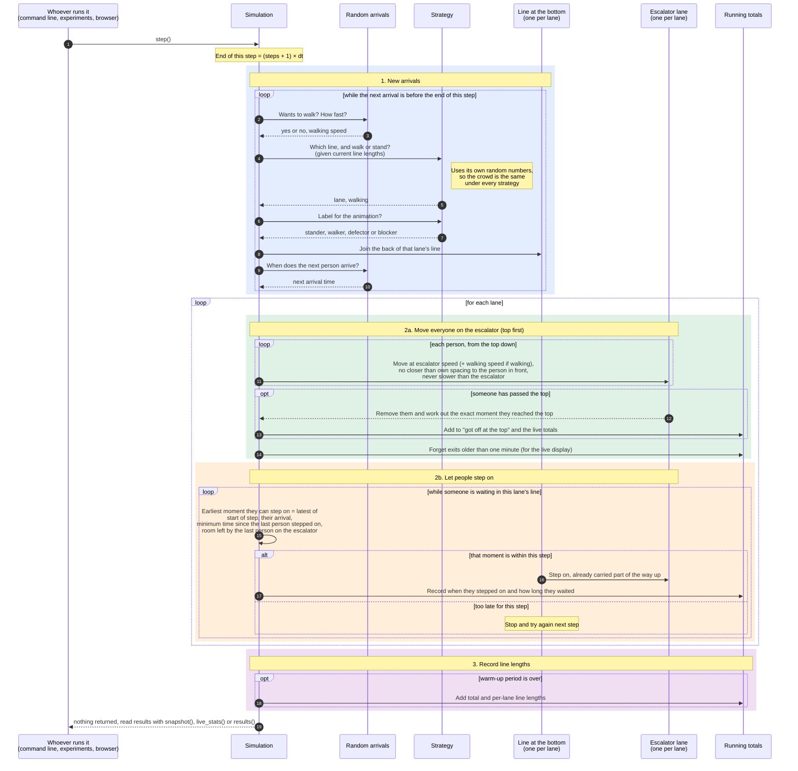

# Engine design: how a simulation runs

This document explains how the simulation itself works, step by step. The code
is mainly in `escalator_sim/engine.py`, with help from `person.py`,
`strategies.py` and `metrics.py`. For how the simulation connects to the
browser app, see `APP_DESIGN.md`. For *why* the model is built this way, see
`PLAN.md`.

The last sections list possible changes to the code and open questions. They
are a starting point for discussion, not an agreed plan.

Names in `code font` are the names used in the code and the settings, so you
can search for them.

## What the simulation keeps track of

The simulation follows every person from the moment they arrive at the bottom
until they step off at the top. At any moment, each person is in exactly one of
three places:

| Where | In the code | Order |
|---|---|---|
| Waiting at the bottom of a lane | `queues[lane]` | first in line first |
| On the escalator | `on_belt[lane]` | person nearest the top first |
| Arrived at the top | `finished` | in the order they got off |

People only ever move forward through these three places. A separate list,
`people`, holds everyone who has arrived so far, in order of arrival.

Lane 0 is the left lane, where people walk under the stand-right/walk-left
rule.

For each lane, the simulation also remembers when someone last stepped on
(`_last_board`). That is used to keep the minimum time between two people
stepping on (the `board_headway` setting).

As it goes, the simulation also keeps two sets of running totals:

- **Line lengths**, recorded once per step after the warm-up period, for the
  final results.
- **Quick totals** for the live animation (people who got off in the last
  minute, average wait so far, how many walked). These include the warm-up, and
  they are cheap enough to read many times a second.

## What happens in one step

The simulation moves forward in small, fixed slices of time (the `dt` setting,
0.1 s by default). Each slice is one step and does three things in this order:

1. **New arrivals**: add everyone who arrives during this slice, and let each
   choose a lane.
2. **For each lane**: first move everyone on the escalator, then let people
   step on from the front of the line. Moving comes first, so the people
   stepping on see the space that has just opened up.
3. **Record line lengths** (after the warm-up period only).

The diagram below shows one step in full. "Running totals" is drawn
separately to show which moments produce measurements, although in the code
the totals are kept inside the simulation itself.

The clock is calculated as "number of steps × `dt`", not by adding `dt` over
and over. Adding the same small number thousands of times builds up tiny
rounding errors in the computer's arithmetic; multiplying avoids that.

### Arrivals

People arrive at random. On average there are `arrival_rate` people per
minute, but each person's arrival is independent of the others. So sometimes
several arrive close together, and sometimes there's a lull. (This is the
standard model for people arriving independently.)

When someone arrives, the simulation decides at random:

- whether they *want* to walk (a `walk_fraction` share of people do), and
- how fast they walk if they do. Speeds vary around `walk_speed_mean`, but are
  never below `walk_speed_min`.

The **strategy** (`strategies.py`) then decides which line they join and
whether they actually walk. For example, under `walk-left`, someone who wants
to walk goes left and walks. Someone who wants to stand usually goes right, but
may give up and walk on the left if the right line is long. The strategy also
gives each person a label for the animation: `stander`, `walker`, `defector`
(a stander who switched to walking) or `blocker` (someone standing in the walk
lane).

### The same crowd for every strategy

All the random choices come from a seed number, so a run can be repeated
exactly. Each random number (`draws.py`) is worked out from three things: the
seed, what it's for (its *purpose*, such as `walk_speed` or `blocker`), and
the person's number. It doesn't depend on any other random number, or on the
order they're used in.

Arrival purposes (when people arrive, whether they want to walk, how fast)
are separate from strategy purposes (line ties, blocking, switching to walk).
So a given seed produces **exactly the same people arriving at exactly the
same times under every strategy**. Only how they're handled differs. This is
what makes the comparison between strategies fair.

Two more results follow:

- **Adding a new random choice changes nothing that exists.** A new purpose
  gets its own numbers, so the crowd and every existing choice stay the same.
- **Sweeps compare like with like.** Person 12 has the same underlying
  numbers at every `walk_fraction` or `arrival_rate`, so the points differ
  only by the setting.

> Renaming a purpose, or changing how one turns into a value, changes the
> results for every seed. Add a new purpose instead.

### Moving people on the escalator

Each lane is handled from the top down, so each person already knows where the
person in front of them has just moved to. Each person:

1. would like to move at the escalator's speed, plus their walking speed if
   they walk;
2. but can't get closer to the person in front than their own minimum spacing
   (`walk_gap` if they walk, `stand_gap` if they stand);
3. and never moves slower than the escalator, because the steps carry them.

The spacing is the follower's own: a walker behind a stander keeps the walking
spacing. Because nobody goes slower than the escalator, people who are already
properly spaced can never be pushed closer together by rule 3.

When someone passes the top, they're removed from the lane. Their arrival time
at the top is worked out precisely (how far past the top they went, divided by
their speed), rather than rounded to the end of the step. So results don't
depend on how big the time slices are.

### Stepping on

For the person at the front of a line, the simulation works out the **exact
moment within the step** when they can step on. It is the latest of:

- the start of this step;
- when they arrived;
- `board_headway` seconds after the previous person in that lane stepped on;
- when the last person on that lane was far enough up to leave room (one
  spacing).

If that moment falls within this step, they step on and have already been
carried part of the way up by the end of the step. The next person in line is
then checked the same way, so **several people can step on in one step**.

Working out exact moments (here and at the top) means the number of people a
lane can carry per minute doesn't change if the time slices are made smaller
or larger.

Two simplifications:

- To find "when the last person was far enough up", the simulation assumes
  they moved at a steady speed during the step.
- **Someone who steps on partway through a step is carried at the escalator's
  speed until the step ends, even if they're a walker.** Walkers lose a tiny
  amount of walking each time (at most their walking speed × 0.1 s, so a few
  centimeters). This makes their trip very slightly slower than it should be.

## Getting results out

The simulation offers three views of what is happening:

| Method | What it gives | Leaves out the warm-up? | Used by |
|---|---|---|---|
| `snapshot()` | Where everyone is right now | no | drawing the animation |
| `live_stats()` | The quick running totals | no | the animation's live numbers |
| `results()` | The full measurements | yes | command line, experiments, end of an animated run |

`results()` is calculated in `metrics.py` (`summarize()`), which goes through
the simulation's lists of people:

- **People per minute** counts everyone who got off at the top between the end
  of the warm-up and the current time.
- **Waits and trip times** cover people who *arrived* after the warm-up.
  Anyone still waiting at the end counts with the time they've waited so far.
  So when the escalator can't keep up, the reported waits are, if anything, too
  short, rather than leaving out the people who waited longest.
- A warning is added if the warm-up is shorter than one ride from bottom to
  top. Otherwise the first minutes are measured before anyone could possibly
  have reached the top, and people per minute comes out too low.

## What decides when a run ends

| Who runs the simulation | When it stops |
|---|---|
| Command line `run` (`cli.py`) | at `duration` |
| Experiments (`experiments.py`) | at `duration` |
| Browser animation (`session.py`) | moves forward in chunks, never past `duration`; reports when it's done |

So "the run ends at `duration`" is assumed in three places: `run()`, `done`,
and the browser's stepping in `session.py`.

## Possible changes to the code

These came up while reading the code with the time-saved plan
(`TIME_SAVED_PLAN.md` in this folder, currently on the `feature/time-saved` branch) in
mind. That plan lets everyone who arrived
finish their trip after `duration` (it calls this the "drain"), and reports
trip times separately for people who want to walk and everyone else.

1. **"End of measuring" and "current time" are the same thing today.**
   `summarize()` treats the current time as the end of the measuring period.
   If the simulation keeps running after `duration` to let people finish, that
   would make the measuring period longer and change people per minute and the
   waits. The two need to be kept separate.
2. **Arrivals never stop.** New people keep arriving for as long as the
   simulation runs. Once `duration` is reached, arrivals need to stop, and
   recording line lengths should probably stop too.
3. **"Done" means one thing in three places.** All three places in the table
   above assume the run ends at `duration`. Letting people finish means
   deciding whether "done" means "measuring is over" or "everyone has reached
   the top", and whether the animation shows people finishing.
4. **The measurements are mixed into the simulation.** `summarize()` reads the
   simulation's internal running totals directly, and the quick totals for the
   animation partly repeat them. One option is to move all measuring into a
   separate piece of code that the simulation tells about events ("someone
   stepped on", "someone got off", "a step ended"). That would keep the
   movement rules and the measuring apart, and give the new
   "walkers vs. everyone else" trip times an obvious place to live.
5. **Smaller points:**
   - Removing someone from the top of a lane makes the computer shuffle the
     rest of that lane's list along by one. That's fine with a few dozen people
     per lane, but would slow down with far more.
   - Each person looks up their spacing in the settings every time they move.
     It could be stored on the person when they arrive.
   - Each person's label (`stander`, `walker`, …) is decided once, on arrival.
     That's only correct while people can't change lanes or start or stop
     walking once on the escalator.

### What any change must keep

- **The same results for the same seed.** Compare the output of
  `python3 -m escalator_sim run` before and after.
- **The existing random-number purposes in `draws.py`**, unchanged. Add new
  ones instead, so the crowd stays the same.
- **The rules that let the same code run in the browser** (see `CLAUDE.md`):
  only Python's built-in libraries; results as plain lists, numbers and text;
  no reading or writing files; no waiting or background tasks.
- **The list of code files in `web/manifest.json`**, if files are added or
  removed.

## Open questions

- Should letting people finish be part of the simulation itself (for example, a
  setting), or a separate stage that whoever runs the simulation adds after
  `duration`?
- Should the animation show people finishing after `duration`, or stop at
  `duration` as it does now?
- Is it worth separating the measuring code now, or only once the
  "walkers vs. everyone else" trip times are added?
- Should the stepping-on simplification for walkers be fixed? It slightly
  reduces the time walkers save, which is exactly what this branch measures.
